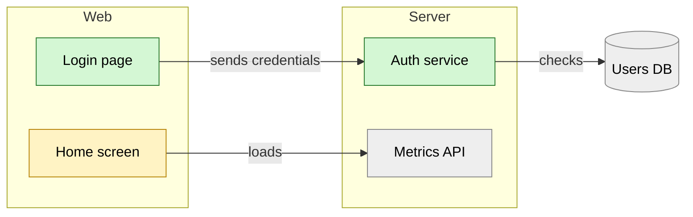

# Kit: readable diagrams

A diagram must show one idea at one zoom level. Most unreadable diagrams mix levels, cram too many boxes, or let arrows cross everywhere. Inspired by the C4 model: pick a zoom level, stay on it.

## Pick the type

- How parts connect (system overview, data flow): `flowchart`.
- What happens over time between parts (login, request, payment): `sequenceDiagram`.
- What a feature set contains (feature overview, scope): `mindmap`.
- States of one thing (order, job, account): `stateDiagram-v2`.

One diagram per idea. Two ideas: two diagrams.

## Zoom levels

- Overview: people, the system, external services, data stores. At most 8 nodes.
- Areas: the main modules or screens of the system and how they talk. At most 15 nodes, grouped.
- Detail: the functions or classes of one area. At most 15 nodes per diagram; one diagram per area.

## Layout rules

- One direction for the whole diagram: `flowchart LR` for flows, `TD` for hierarchies.
- Group nodes into `subgraph`s by area. Arrows between groups should be few.
- Order nodes so arrows go forward. No arrow goes back across the diagram unless it is the point.
- Every node is connected. No arrow without a label when the relation is not obvious; labels are verbs: `calls`, `reads`, `sends`.
- Node labels: 1 to 4 words, no code identifiers at the overview and areas levels.
- No bidirectional arrows: draw the main direction only.
- Over the node limit: split by area, do not shrink the font.

## New versus existing

Show what the change added and modified, against what already existed:



Always add a one-line legend under the diagram: `green: new, yellow: changed, grey: existing`.

## Where it renders

- Files and pull requests: Mermaid in a ```` ```mermaid ```` block (GitHub renders it).
- Terminal chat: Mermaid shows as code. Use a compact text diagram instead, at most 12 nodes, new parts marked `*`, changed parts marked `~`:

```
[Login page]* --sends--> [Auth service]* --checks--> (Users DB)
[Home screen]~ --loads--> [Metrics API]
* new  ~ changed
```

## Self-check before showing

- Node count within the level's limit.
- One direction, grouped, few crossing arrows.
- A reader who knows nothing of the code can say what the system does from the diagram alone.
- Mermaid syntax: labels with spaces or symbols in `[...]`, `(...)` or quotes; no parentheses inside a `[...]` label.
